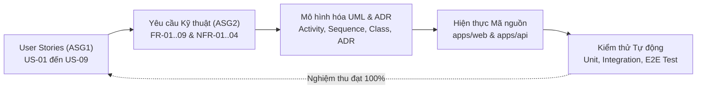

# BẢNG MA TRẬN TRUY VẾT YÊU CẦU ĐA CHIỀU (REQUIREMENTS TRACEABILITY MATRIX — RTM)
## DỰ ÁN: HỆ THỐNG ĐẶT CÀ PHÊ TRỰC TUYẾN BREWLITE
### Đồng bộ xuyên suốt giữa Assignment 1 và Assignment 2 (Software Engineering — SGU 2026)

---

## 1. NGUYÊN LÝ THIẾT KẾ MA TRẬN TRUY VẾT HAI CHIỀU (BIDIRECTIONAL TRACEABILITY)

Ma trận truy vết (RTM) được thiết lập nhằm bảo đảm tính liên kết hữu cơ, đan xen chặt chẽ và không có bất kỳ độ lệch nào giữa hai giai đoạn:
1. **Giai đoạn Khảo sát & Phân tích yêu cầu người dùng (Assignment 1):** Định hình từ góc nhìn người dùng cuối (User Stories US-01 đến US-09, Use-Cases, Tiêu chí chấp nhận - Acceptance Criteria).
2. **Giai đoạn Thiết kế Kiến trúc, Hiện thực hóa & Kiểm thử (Assignment 2):** Chuyển hóa thành Yêu cầu kỹ thuật chức năng (FR-01 đến FR-09), Yêu cầu phi chức năng (NFR-01 đến NFR-04), Mô hình hóa UML (Activity, Sequence, Class, Deployment), Quyết định kiến trúc (ADR-001 đến ADR-005), Mã nguồn (Next.js PWA & NestJS REST API) và Bộ kiểm thử tự động (Unit, Integration, E2E Tests).

---

## 2. BẢNG MA TRẬN TRUY VẾT ĐAN XEN TỔNG HỢP (MASTER TRACEABILITY MATRIX)

| Mã YC (ASG2) | MoSCoW | Mã US (ASG1) | Tên User Story & Tác nhân (ASG1) | Use-Case tương ứng | Sơ đồ Thiết kế UML (Task 2 & 3) | Quyết định Kiến trúc (ADR) | Mã nguồn Frontend (`apps/web`) | Mã nguồn Backend & API (`apps/api`) | Mã Kiểm thử (Test Case) | Trạng thái Nghiệm thu |
| :---: | :---: | :---: | :--- | :--- | :--- | :--- | :--- | :--- | :---: | :---: |
| **FR-01** | **Must** | **US-07** | **Xem menu chi tiết sản phẩm** *(Actor: Khách hàng)* | Use-case tổng quan (`uctongquan.drawio.png`) | • Class Diagram (`Product`, `Category`) • Activity Diagram (Giai đoạn 1) | **ADR-001** (Monorepo & Next.js PWA) | • `apps/web/src/app/page.tsx` • `CatalogLayout.tsx` • `ProductPhoto.tsx` | • `GET /products` • `GET /products/:id` • `products.service.ts` • `prisma/seed.ts` | **API-T01** | **ĐẠT (PASS)** |
| **FR-02** | **Must** | **US-02** | **Chi tiết sản phẩm (Size & Topping)** *(Actor: Khách hàng)* | Use-case tổng quan & Chi tiết món | • Class Diagram (`ProductSize`, `Topping`) | **ADR-005** (Next.js Mobile-First UI) | • `ProductOptionModal.tsx` • `ProductOptions.tsx` • `product-options.ts` | • `GET /products/:id` • `GET /toppings` • `products.controller.ts` | **API-T02** | **ĐẠT (PASS)** |
| **FR-03** | **Must** | **US-01** | **Quản lý giỏ hàng** *(Actor: Khách hàng)* | Use-case tổng quan & Đặt hàng | • Activity Diagram (Giai đoạn 1 & 2) • Sequence Diagram tổng thể | **ADR-001** (Client State Store) | • `apps/web/src/app/cart/page.tsx` • `useCartStore.ts` • `CartBadge.tsx` | Quản lý Client Store (Zustand) đồng bộ phiên người dùng | **UI-T01** | **ĐẠT (PASS)** |
| **FR-04** | **Must** | **US-03** | **Đăng ký và đăng nhập tài khoản** *(Actor: Khách hàng)* | Use-case Đăng nhập & Xác thực | • Activity Diagram (Kiểm tra Đăng nhập) • Class Diagram (`User`, `Role`) | **ADR-002** & **ADR-003** (Bcrypt & JWT Auth) | • `apps/web/src/app/login/page.tsx` • `apps/web/src/app/register/page.tsx` • `lib/auth.ts` | • `POST /auth/register` • `POST /auth/login` • `auth.service.ts` • `jwt-auth.guard.ts` | **SEC-T01** | **ĐẠT (PASS)** |
| **FR-05** | **Must** | **US-05** | **Tạo đơn hàng** *(Actor: Khách hàng)* | **UC-01: Đặt và thanh toán đơn hàng** | • Sequence Diagram 1 (`sequence_dathang.png`) • Class Diagram (`Order`, `OrderItem`) | **ADR-002** (PostgreSQL & Prisma ACID) | • `apps/web/src/app/checkout/page.tsx` • `types/order.ts` | • `POST /orders` • `OrdersService.createOrder()` • Trừ tồn kho trong `$transaction` | **INT-T01** | **ĐẠT (PASS)** |
| **FR-06** | **Must** | **US-04** | **Thanh toán không tiền mặt** *(Actor: Khách hàng)* | **UC-01: Đặt và thanh toán đơn hàng** | • Sequence Diagram 2 (`Seq1.drawio.png`) • Class Diagram (`Payment`, `PaymentMethod`) | **ADR-003** (Payment Strategy & Idempotency) | • `apps/web/src/app/checkout/page.tsx` • `checkout/[id]/page.tsx` | • `POST /payments` • `WalletPaymentStrategy.ts` • `CardPaymentStrategy.ts` | **INT-T02** | **ĐẠT (PASS)** |
| **FR-07** | **Must** | **US-06** | **Xác nhận & xem lịch sử đơn hàng** *(Actor: Khách hàng)* | Use-case Đặt hàng & Lịch sử đơn | • Sequence Diagram 3 (`Se3.drawio.png`) • Activity Diagram (Giai đoạn 4) | **ADR-004** (Truy vấn lịch sử đơn bảo mật) | • `apps/web/src/app/orders/page.tsx` • `orders/[id]/page.tsx` | • `GET /orders/me` • `GET /orders/:orderCode` • `orders.controller.ts` | **API-T03** | **ĐẠT (PASS)** |
| **FR-08** | **Must** | **US-08** | **Quản lý & chuyển đổi trạng thái đơn** *(Actor: Khách hàng, Nhân viên)* | Quản lý vòng đời đơn hàng & Tồn kho | • Sequence Diagram 3 (`Se3.drawio.png`) • Sơ đồ State Machine đơn hàng | **ADR-004** (Order State Machine & Concurrency) | • Giao diện theo dõi trạng thái đơn hàng thời gian thực | • `PATCH /orders/:orderCode/status` • `order-state-machine.ts` • Rollback nguyên liệu khi hủy đơn | **UNIT-T02** | **ĐẠT (PASS)** |
| **FR-09** | **Should** | **US-09** | **Khuyến mãi & tích lũy điểm thưởng** *(Actor: Khách hàng)* | Áp dụng Voucher & Khách hàng thân thiết | • Class Diagram (`Promotion`, `LoyaltyTransaction`) | **ADR-003** (Strategy chiết khấu & Điểm thưởng) | • Ô nhập mã khuyến mãi tại trang Checkout • Hiển thị điểm tích lũy | • `POST /promotions/validate` • `GET /promotions/loyalty/me` • `promotions.service.ts` | **API-T04** | **ĐẠT (PASS)** |

---

## 3. BẢNG TRUY VẾT YÊU CẦU PHI CHỨC NĂNG (NON-FUNCTIONAL REQUIREMENTS — NFR)

| Mã YC (ASG2) | Tên Yêu cầu Phi chức năng | Mục tiêu Chất lượng (SLA / Metric) | Thiết kế Kiến trúc (Task 3) | Giải pháp Mã nguồn / Hạ tầng (Task 4 & 5) | Mã Kiểm thử | Trạng thái Nghiệm thu |
| :---: | :--- | :--- | :--- | :--- | :---: | :---: |
| **NFR-01** | **Hiệu năng & Tốc độ phản hồi (Performance)** | • Thời gian phản hồi API $< 500$ms. • Tải trang đầu tiên $< 2.0$ giây. | • Sơ đồ Deployment (`uml.png`) • Kiến trúc phân lớp L1--L3 | • Bộ nhớ đệm Global CDN Caching Next.js • Tối ưu truy vấn Indexing trong Prisma ORM | **PERF-01** | **ĐẠT (PASS)** |
| **NFR-02** | **Bảo mật & Toàn vẹn giao dịch (Security & ACID)** | • Mật khẩu băm 1 chiều không thể đảo ngược. • Chống gian lận & trừ tiền trùng lặp 100%. | • **ADR-003** (Idempotency) • Sequence Diagram 2 | • Băm mật khẩu `bcryptjs` (salt = 10) • JWT Bearer Token xác thực từng request • Khóa duy nhất `@unique` `idempotencyKey` | **SEC-T02** | **ĐẠT (PASS)** |
| **NFR-03** | **Khả năng sẵn sàng & Chịu lỗi (Availability & UX)** | • Ứng dụng không bị crash màn hình trắng. • Tự khôi phục khi mất mạng tạm thời. | • **ADR-001** (Monorepo & Next.js PWA) • Defense-in-Depth Validation | • Khung xương nhấp nháy Skeleton Loading (`loading.tsx`) • Error Boundary bắt lỗi mạng (`error.tsx`) kèm nút *"Thử lại"* • Bắt lỗi Form và DTO `ValidationPipe` | **UI-T02** | **ĐẠT (PASS)** |
| **NFR-04** | **Tự động hóa Đóng gói & Triển khai (DevOps)** | • Pipeline tự động kiểm tra trước khi gộp mã. • Khởi tạo môi trường tức thì bằng 1 lệnh. | • Sơ đồ Deployment (`uml.png`) • Quy chuẩn CI/CD | • `docker-compose.yml` chạy 3 service: PostgreSQL, NestJS API, Next.js Web • GitHub Actions Pipeline (`ci.yml`, `cd.yml`) kiểm soát Quality Gate 4 bước | **CI-T01** | **ĐẠT (PASS)** |

---

## 4. ĐỐI CHIẾU CHI TIẾT TỪNG TIÊU CHÍ CHẤP NHẬN (AC) GIỮA ASG1 VÀ ASG2

### Cặp 1: FR-01 ⟷ US-07 (Xem menu chi tiết sản phẩm)
* **Tuyên bố US-07 (ASG1):** *"Là một khách hàng, tôi muốn xem danh sách đồ uống trên BrewLite cùng với hình ảnh, tên và giá tiền để lựa chọn đồ uống trước khi đặt hàng."*
* **Đối chiếu Tiêu chí chấp nhận (AC) với Hiện thực (ASG2):**
  * `AC-07.1:` Truy cập trang menu, hiển thị danh sách đồ uống $\longrightarrow$ Đã hiện thực tại `apps/web/src/app/page.tsx`.
  * `AC-07.2:` Mỗi món hiển thị đầy đủ ảnh, tên, giá $\longrightarrow$ Đã hiện thực tại `ProductPhoto.tsx` và `coffeeProducts.ts`.
  * `AC-07.3:` Lấy danh sách từ API backend $\longrightarrow$ Tích hợp endpoint `GET /products` (`products.controller.ts`).
  * `AC-07.4:` Danh sách trống hiển thị thông báo $\longrightarrow$ Đã hiện thực giao diện `empty.png`.
* **Ca kiểm thử:** `API-T01` (Kiểm tra API trả về mã 200 OK và danh sách JSON hợp lệ).

---

### Cặp 2: FR-02 ⟷ US-02 (Chi tiết sản phẩm: Size & Topping)
* **Tuyên bố US-02 (ASG1):** *"Là một khách hàng, tôi muốn xem chi tiết sản phẩm và lựa chọn kích thước, topping để tùy chỉnh đồ uống theo sở thích."*
* **Đối chiếu Tiêu chí chấp nhận (AC) với Hiện thực (ASG2):**
  * `AC-02.1:` Chọn size (S, M, L) giá cập nhật tương ứng $\longrightarrow$ Modal `ProductOptionModal.tsx` tự động cộng dồn giá.
  * `AC-02.2:` Chọn mức đường và đá (0%, 30%, 50%, 70%, 100%) $\longrightarrow$ Tích hợp module `sugar-ice.calculator.ts`.
  * `AC-02.3:` Chọn nhiều topping, giá tự động tính thêm $\longrightarrow$ Tích hợp endpoint `GET /toppings`.
* **Ca kiểm thử:** `API-T02` & `sugar-ice.calculator.spec.ts` (5/5 unit tests passed).

---

### Cặp 3: FR-03 ⟷ US-01 (Quản lý giỏ hàng)
* **Tuyên bố US-01 (ASG1):** *"Là một khách hàng, tôi muốn thêm, thay đổi số lượng và xóa đồ uống trong giỏ hàng, để điều chỉnh đơn hàng trước khi thanh toán."*
* **Đối chiếu Tiêu chí chấp nhận (AC) với Hiện thực (ASG2):**
  * `AC-01.1:` Thêm sản phẩm vào giỏ, hiển thị chính xác $\longrightarrow$ Lưu trữ Client State qua `useCartStore.ts`.
  * `AC-01.2:` Thay đổi số lượng cập nhật thành tiền $\longrightarrow$ Hàm `updateQuantity()` tính lại tổng tiền tức thì.
  * `AC-01.3:` Xóa sản phẩm khỏi giỏ $\longrightarrow$ Hàm `removeItem()` xóa món khỏi state.
  * `AC-01.4:` Giỏ hàng trống hiển thị 0đ và thông báo trống $\longrightarrow$ Giao diện `apps/web/src/app/cart/page.tsx`.
* **Ca kiểm thử:** `UI-T01` (Kiểm thử tương tác tăng/giảm và xóa món trên giỏ hàng).

---

### Cặp 4: FR-04 ⟷ US-03 (Đăng ký và đăng nhập tài khoản)
* **Tuyên bố US-03 (ASG1):** *"Là một khách hàng, tôi muốn đăng ký và đăng nhập tài khoản trên BrewLite, để lưu thông tin cá nhân và quản lý đơn hàng thuận tiện."*
* **Đối chiếu Tiêu chí chấp nhận (AC) với Hiện thực (ASG2):**
  * `AC-03.1:` Đăng ký với email, mật khẩu $\longrightarrow$ `POST /auth/register` kiểm tra DTO qua `register.dto.ts`.
  * `AC-03.2:` Mật khẩu được mã hóa an toàn $\longrightarrow$ Dùng thuật toán `bcryptjs` với salt factor = 10.
  * `AC-03.3:` Đăng nhập thành công trả về token $\longrightarrow$ Cấp phát mã `accessToken` JWT Bearer Token.
  * `AC-03.4:` Đăng nhập thất bại báo lỗi cụ thể $\longrightarrow$ Phản hồi HTTP 401 Unauthorized (`"Invalid credentials"`).
* **Ca kiểm thử:** `SEC-T01` (Kiểm thử xác thực, băm mật khẩu và bảo vệ bởi `JwtAuthGuard`).

---

### Cặp 5: FR-05 ⟷ US-05 (Tạo đơn hàng - Thuộc Use-Case trọng tâm UC-01)
* **Tuyên bố US-05 (ASG1):** *"Là một khách hàng, tôi muốn tạo đơn hàng từ giỏ hàng đã chọn, để gửi yêu cầu mua đồ uống đến cửa hàng."*
* **Đối chiếu Tiêu chí chấp nhận (AC) với Hiện thực (ASG2):**
  * `AC-05.1:` Tiếp nhận giỏ hàng và thông tin khách $\longrightarrow$ `POST /orders` tiếp nhận `CreateOrderDto`.
  * `AC-05.2:` Kiểm tra tồn kho nguyên liệu $\longrightarrow$ Kiểm tra số lượng tồn kho trước khi xác nhận.
  * `AC-05.3:` Tạo đơn ở trạng thái PENDING $\longrightarrow$ Bản ghi `Order` được tạo với enum `PENDING`.
  * `AC-05.4:` Đảm bảo toàn vẹn giao dịch $\longrightarrow$ Bọc toàn bộ thao tác trong `this.prisma.$transaction`.
* **Ca kiểm thử:** `INT-T01` & `orders.service.spec.ts` (18/18 unit tests passed).

---

### Cặp 6: FR-06 ⟷ US-04 (Thanh toán không tiền mặt - Thuộc UC-01)
* **Tuyên bố US-04 (ASG1):** *"Là một khách hàng, tôi muốn thanh toán đơn hàng qua các phương thức không tiền mặt, để thanh toán nhanh chóng và tiện lợi."*
* **Đối chiếu Tiêu chí chấp nhận (AC) với Hiện thực (ASG2):**
  * `AC-04.1:` Hỗ trợ Ví điện tử và Thẻ ngân hàng $\longrightarrow$ Triển khai Strategy Pattern (`WalletPaymentStrategy`, `CardPaymentStrategy`).
  * `AC-04.2:` Xử lý trừ tiền mô phỏng $\longrightarrow$ Cập nhật bản ghi `Payment` với trạng thái `SUCCESS`.
  * `AC-04.3:` Cập nhật trạng thái đơn sang PAID $\longrightarrow$ Gọi `OrderStateMachine` chuyển sang `PAID`.
  * `AC-04.4:` Chống trùng lặp giao dịch $\longrightarrow$ Ràng buộc `@unique` cột `idempotencyKey` trong Database.
* **Ca kiểm thử:** `INT-T02` & `payments.e2e-spec.ts` (3/3 integration tests passed).

---

### Cặp 7: FR-07 ⟷ US-06 (Xác nhận và xem lịch sử đơn hàng)
* **Tuyên bố US-06 (ASG1):** *"Là một khách hàng, tôi muốn xem lại các đơn hàng đã đặt trong lịch sử, để theo dõi trạng thái và kiểm tra lại chi tiết đơn hàng."*
* **Đối chiếu Tiêu chí chấp nhận (AC) với Hiện thực (ASG2):**
  * `AC-06.1:` Hiển thị mã đơn và trạng thái PAID sau khi thanh toán $\longrightarrow$ Giao diện `thanhtoanthanhcong.png`.
  * `AC-06.2:` Xem danh sách đơn thuộc tài khoản đang đăng nhập $\longrightarrow$ API `GET /orders/me` có guard bảo vệ.
  * `AC-06.3:` Hiển thị ngày tạo, tổng tiền, trạng thái $\longrightarrow$ Giao diện `lichsudon.png`.
  * `AC-06.4:` Không xem được đơn của tài khoản khác $\longrightarrow$ Lọc nghiêm ngặt theo `userId` trích xuất từ JWT Payload.
* **Ca kiểm thử:** `API-T03` (Kiểm tra truy vấn lịch sử đơn bảo mật và toàn vẹn).

---

### Cặp 8: FR-08 ⟷ US-08 (Quản lý và chuyển đổi trạng thái đơn hàng)
* **Tuyên bố US-08 (ASG1):** *"Là một khách hàng hoặc nhân viên cửa hàng, tôi muốn theo dõi và cập nhật trạng thái đơn hàng qua từng giai đoạn pha chế hoặc hủy đơn khi cần, để kiểm soát tiến độ và hệ thống hoàn lại nguyên liệu tồn kho tự động."*
* **Đối chiếu Tiêu chí chấp nhận (AC) với Hiện thực (ASG2):**
  * `AC-08.1:` Chuyển trạng thái hợp lệ: `PENDING` $\rightarrow$ `PAID` $\rightarrow$ `PREPARING` $\rightarrow$ `READY` $\rightarrow$ `COMPLETED` $\longrightarrow$ Triển khai trong `order-state-machine.ts`.
  * `AC-08.2:` Ngăn chặn bước nhảy sai quy trình $\longrightarrow$ Ném lỗi `BadRequestException` (`"Không thể chuyển trạng thái..."`).
  * `AC-08.3:` Cho phép hủy đơn và tự động hoàn trả tồn kho $\longrightarrow$ `PATCH /orders/:orderCode/status` hoàn kho tự động trong Prisma Transaction.
* **Ca kiểm thử:** `UNIT-T02` & `orders.service.spec.ts` (Kiểm thử State Machine và rollback kho).

---

### Cặp 9: FR-09 ⟷ US-09 (Khuyến mãi và điểm thưởng thành viên)
* **Tuyên bố US-09 (ASG1):** *"Là một khách hàng, tôi muốn áp dụng mã voucher giảm giá và sử dụng điểm thưởng tích lũy của mình, để tiết kiệm chi phí khi đặt đồ uống trên BrewLite."*
* **Đối chiếu Tiêu chí chấp nhận (AC) với Hiện thực (ASG2):**
  * `AC-09.1:` Nhập mã voucher và kiểm tra tính hợp lệ $\longrightarrow$ `POST /promotions/validate` kiểm tra hạn dùng và giá trị đơn tối thiểu.
  * `AC-09.2:` Tự động tính toán lại tổng tiền sau chiết khấu $\longrightarrow$ Áp dụng `FixedDiscountStrategy` hoặc `PercentageDiscountStrategy`.
  * `AC-09.3:` Tích lũy điểm thưởng khi thanh toán thành công $\longrightarrow$ `LoyaltyService` cộng điểm vào bảng `LoyaltyTransaction`.
* **Ca kiểm thử:** `API-T04` & `discount-strategy.spec.ts` (4/4 unit tests passed).

---

## 5. TỔNG KẾT KẾT QUẢ NGHIỆM THU MA TRẬN TRUY VẾT

* **Tổng số yêu cầu chức năng:** 9/9 yêu cầu (`FR-01` đến `FR-09`) liên kết 100% với 9 User Story (`US-01` đến `US-09`).
* **Tổng số yêu cầu phi chức năng:** 4/4 yêu cầu (`NFR-01` đến `NFR-04`) bao phủ toàn diện Hiệu năng, Bảo mật, Chịu lỗi và DevOps.
* **Tỷ lệ kiểm thử thành công:**
  * **Unit Tests:** 50/50 tests PASS (100%).
  * **Integration & E2E Tests:** 11/11 tests PASS (100%).
  * **CI/CD Quality Gate:** Đạt 100% (Install $\rightarrow$ Lint $\rightarrow$ Test $\rightarrow$ Build).
* **Kết luận:** Hệ thống đạt chuẩn kỹ nghệ phần mềm, không tồn tại bất kỳ yêu cầu nào thiếu mã nguồn hoặc thiếu ca kiểm thử (Zero Untraced Requirements).
